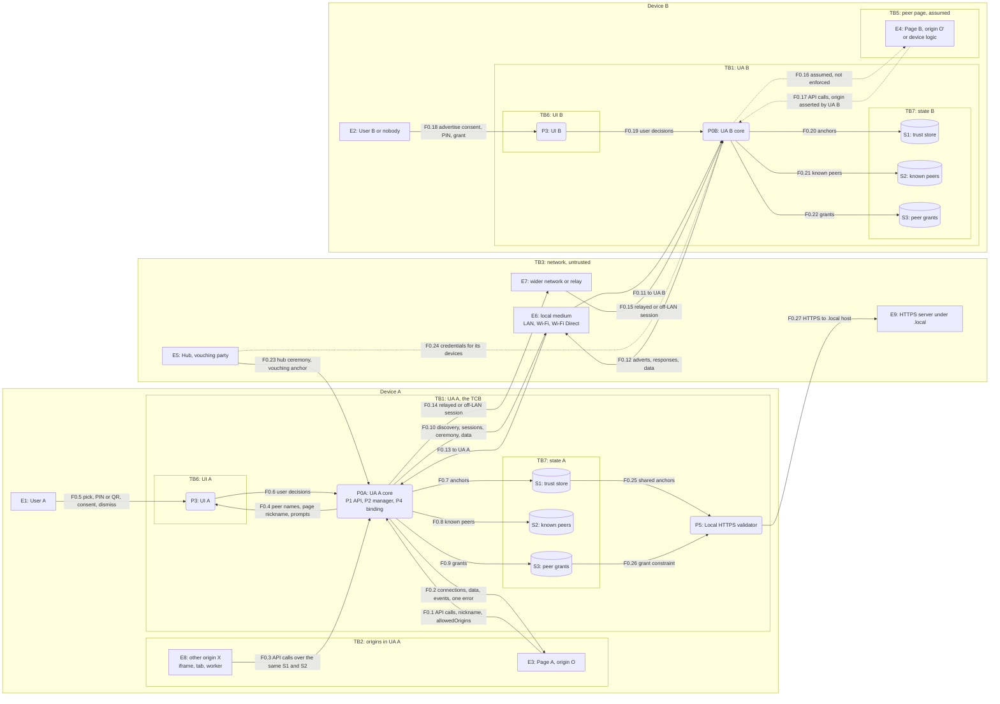
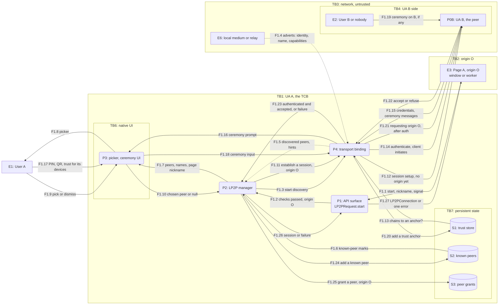
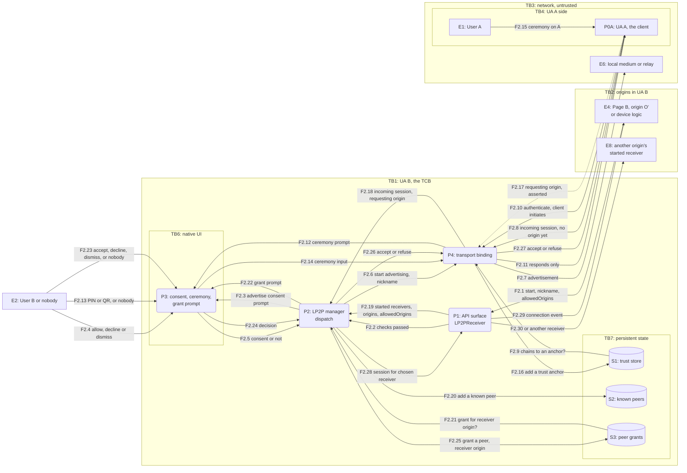
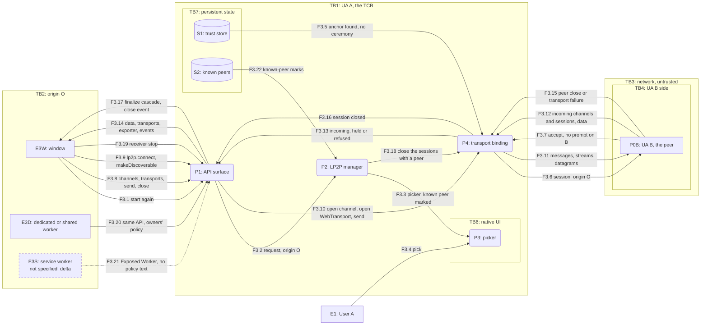
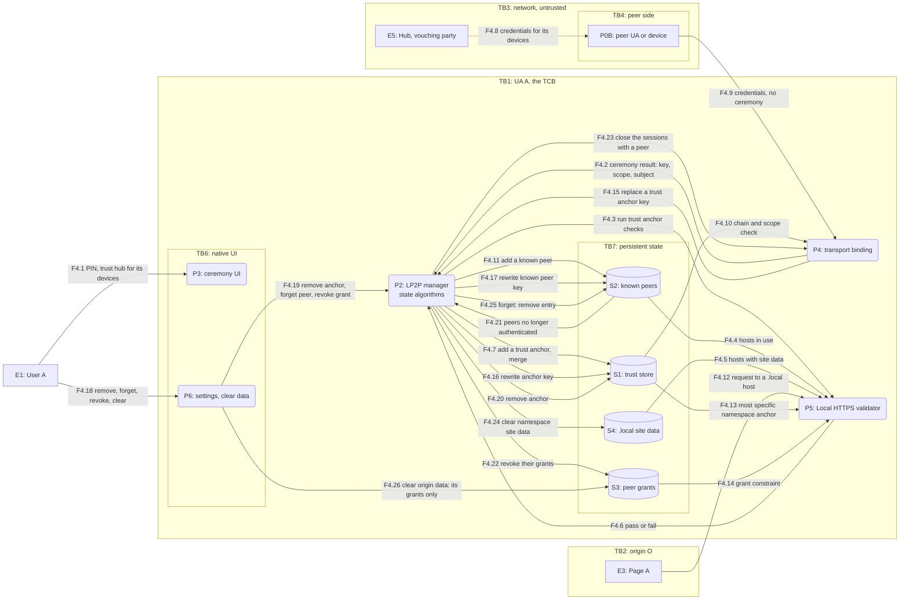

# LP2P threat model: data-flow diagrams

Decomposition of the Local Peer-to-Peer API and its transport-binding contract.
Framing, principals, adversaries and assets are in `00-framing.md`.

## Conventions

- `flowchart LR`. External entity = rectangle `[ ]`; process = rounded `( )`;
  data store = cylinder `[( )]`.
- Each trust boundary is a `subgraph` named `TBn: ...`. A boundary with two
  sides (`TB4`) gets one subgraph per side. A flow crosses a boundary when its
  edge crosses the subgraph border; the tables name the boundaries crossed.
- Dashed edges `-.->` are asserted, not verified: the remote UA <-> remote page
  link (`TB5`, "assumed, not enforced"), the requesting origin, discovery
  hints, and credentials a hub issues. A dashed node border marks something
  not in the spec today (a delta).
- IDs are stable across diagrams. Flow IDs are in the edge labels: `F0.n`
  context, `F1.n` connect, `F2.n` advertise and incoming, `F3.n` steady state
  and lifecycle, `F4.n` trust store.
- Processes `P1`-`P6` and stores `S1`-`S4` exist in every UA. D1 draws them in
  UA A (client), D2 in UA B (server), D3 and D4 in UA A. The other UA is then
  drawn as an external rectangle with its `P0` ID (`P0A`, `P0B`). In D0 both
  UAs appear, so node IDs carry an `A` or `B` suffix (`S1A`, `S1B`).
- The network is not a principal. D0 draws it as `E6` and `E7` inside `TB3`,
  with the hub `E5` and the `.local` server `E9`; D1 to D4 draw the peer UA
  (and in D4 the hub) inside the `TB3` subgraph, so every edge to them
  crosses the network.
- In D0 the outer boxes are devices, not boundaries: every edge between
  Device A and Device B crosses `TB4` (`F0.10`-`F0.15`, `F0.23`, `F0.24`).

## Element catalogue

| ID | Element | Kind | Principal | Spec anchor |
|---|---|---|---|---|
| `E1` | User A | External | `PR-USR-A` | "Peer grant" |
| `E2` | User B, or nobody on a headless peer | External | `PR-USR-B` | "Peer advertisement", "Incoming sessions" |
| `E3` | Page A, origin O: window (`E3W`), dedicated or shared worker (`E3D`), service worker (`E3S`, delta) | External | `PR-PAGE-A` | "Permission Policy Integration" |
| `E4` | Page B, origin O', or device logic | External | `PR-PAGE-B` | "Impact on same-origin policy" |
| `E5` | Hub, vouching party | External | `PR-HUB` | "Peer authentication" |
| `E6` | Local communication medium: LAN, Wi-Fi, Wi-Fi Direct | External (edge) | none; `ADV-NET-LAN` sits here | "Terminology" |
| `E7` | Wider network or relay | External (edge) | none; `ADV-NET-WAN` sits here | "Transport abstraction" |
| `E8` | Another origin X in the same UA: iframe, other tab, worker; or another origin's receiver | External | `PR-PAGE-X` | "Permission Policy Integration", "Incoming sessions" step 2 |
| `E9` | HTTPS server under `.local` (a device or hub service) | External | part of `PR-UA-B` or `PR-HUB` | Local HTTPS "Validation" |
| `P0A`, `P0B` | User agent A, B, collapsed (P1, P2, P4) | Process | `PR-UA-A`, `PR-UA-B` | "Peer Management" |
| `P1` | API surface: `LP2PRequest`, `LP2PReceiver`, `LP2PConnection`, data channels, `LP2PQuicTransport`, listener, `lp2p` | Process | `PR-UA-*` | interface sections |
| `P2` | Local peer-to-peer manager: discovery, grants, dispatch, state algorithms | Process | `PR-UA-*` | "Peer Management", "Local state" |
| `P3` | Native UI: picker, ceremony, advertise consent, grant prompt | Process | `PR-UA-*` | "Peer grant", "User interface guidelines" |
| `P4` | Transport binding: the operations of "Operations" | Process | `PR-UA-*` | "Transport abstraction" |
| `P5` | Local HTTPS validator, including its trust anchor check | Process | `PR-LHTTPS` | Local HTTPS "Trust anchors", "Validation" |
| `P6` | Settings and data clearing: view and remove anchors, peers, grants; clear site data | Process | `PR-UA-*` | "Local state" (last paragraph) |
| `S1` | Local trust store: trust anchors (key, scope, subject) | Store | `AS-ANCHOR` | "Local state", "Peer authentication" |
| `S2` | Known peers map: identity to anchor key and subject | Store | `AS-KNOWN` | "Local state" |
| `S3` | Peer grants: origin to set of peer identities | Store | `AS-GRANT` | "Local state" |
| `S4` | Site data of `.local` origins | Store | `AS-LSITE` | Local HTTPS "Origins, Fetch and Local Network Access" |

## D0: context

| ID | Element or flow | What crosses (boundaries) | Spec anchor | Notes |
|---|---|---|---|---|
| D0 elements | `E1`-`E9`, `P0A`, `P0B`, `P3A`, `P3B`, `P5A`, `S1A`-`S3B` | | catalogue | |
| `F0.1` | Page A -> UA A | Calls, `nickname`, `allowedOrigins`, labels, data (`TB1`) | interface sections | Every argument hostile. Secure context, Permissions Policy, non-opaque origin |
| `F0.2` | UA A -> Page A | `LP2PConnection`, channels, transports, events, one `NotAllowedError` (`TB1`) | "The LP2PRequest Interface" | No peer attributes reach origins ("Personally identifiable information") |
| `F0.3` | Origin X -> UA A | Calls from another origin (`TB2`) | "Local state" Note; LP2P issue 24 | `S1`, `S2` shared by all origins; `S3` per origin |
| `F0.4` | UA A -> UI A | Display names (asserted by peers), nickname (chosen by script), known marks, origin | "Peer grant", "Peers and sessions" | Mixed-trust strings in native UI (`TB6`) |
| `F0.5` | User A -> UI A | Pick, PIN or QR, vouching choice, consent, dismiss (`TB6`) | "Peer grant" | Dismissal not detectable |
| `F0.6` | UI A -> UA A | Decisions | "Peer grant" | |
| `F0.7`-`F0.9` | UA A <-> `S1A`-`S3A` | Anchors, known peers, grants (`TB7`) | "Local state" | Persisted per binding rules; implementation-defined storage |
| `F0.10`-`F0.13` | UA A <-> medium <-> UA B | Adverts, discovery, session setup, ceremony, origin after auth, channels (`TB3`, `TB4`) | "Operations" | Pre-auth content untrusted; contract promises C+I end to end |
| `F0.14`, `F0.15` | UA A <-> relay <-> UA B | Same as above over an intermediary or an exposed NAT (`TB3`, `TB4`) | "Transport abstraction"; OSP "Remote active network attackers" | C+I promised; locality, presence, metadata not |
| `F0.16` | UA B -> Page B | Delivered session (`TB5`) | "Peers and sessions" | **Assumed, not enforced**: A cannot check which page receives it |
| `F0.17` | Page B -> UA B | Calls; the origin UA B will assert | "Peers and sessions" | Dashed: on a headless peer there is no page, the device picks the origin |
| `F0.18`, `F0.19` | User B <-> UI B | Advertise consent, ceremony, grant prompt (`TB6`) | "Peer advertisement", "Incoming sessions" | Absent on a headless peer |
| `F0.20`-`F0.22` | UA B <-> `S1B`-`S3B` | B's anchors, known peers, grants (`TB7`) | "Local state" | Not visible to A |
| `F0.23` | Hub -> UA A | Hub ceremony; adds a vouching anchor (`TB3`, `TB4`) | "Peer authentication" | Runs over the network like any ceremony; SETTLE scope |
| `F0.24` | Hub -> UA B | Credentials for the hub's devices | "Peer authentication" | Dashed: binding-defined, verified only as a chain at A |
| `F0.25` | `S1A` -> Local HTTPS | Same anchors validate `.local` servers (`TB7`) | Local HTTPS "Trust anchors" | Shared store |
| `F0.26` | `S3A` -> Local HTTPS | Grant constraint per origin | Local HTTPS "Scopes" | |
| `F0.27` | Local HTTPS -> `.local` server | HTTPS (`TB3`) | Local HTTPS "Validation" | Rest of Local HTTPS deferred to an annex |

## D1: connect (client side)

`LP2PRequest.start()` in UA A, first contact.

Elements: `E1`, `E2`, `E3`, `E6`, `P0B` (external here), `P1`-`P4`, `S1`-`S3`.

| ID | Flow | What crosses (boundaries) | Spec anchor | Notes |
|---|---|---|---|---|
| `F1.1` | Page -> API | `nickname`, `AbortSignal` (`TB1`) | "The LP2PRequest Interface" | Nickname is script-chosen and shown in UA UI. Abort takes down UI and session |
| `F1.2` | API -> manager | Origin O, after Permissions Policy and opaque-origin checks | "The LP2PRequest Interface" (`start()`), "Permission Policy Integration" | Failing checks reject with `NotAllowedError` synchronously |
| `F1.3` | Start discovery | | "Peer discovery", "Operations" (`discover peers`) | Runs only while the picker is up |
| `F1.4` | Adverts from the medium | Peer identity, display name, capabilities (`TB3`) | "Operations": "A discovered peer identity is not verified" | **Asserted.** Hints only; spoofable by `ADV-NET-LAN`, `ADV-PEER-NEW` |
| `F1.5` | Discovered peers | Hints | "Peer discovery" | Never exposed to the origin in full |
| `F1.6` | Known-peer marks | Peer identities in `S2` | "Peer grant" (`acquire a local peer grant`) | Mark is keyed on an unverified discovered identity until auth |
| `F1.7` | Picker content | Display names (peer-asserted), page nickname, known marks, origin O | "Peer grant", "User interface guidelines" | UA may filter by capabilities. LP2P issue 15 open |
| `F1.8` | Picker shown | Same, to User A (`TB6`) | "Peer grant" | |
| `F1.9` | Pick or dismiss | User choice (`TB6`) | "Peer grant": "Selecting a peer is the user's consent." | Dismissal not detectable by script |
| `F1.10` | Chosen peer or null | | "The LP2PRequest Interface" | Null -> same error as every other failure |
| `F1.11` | Establish a session | Origin O as requesting origin | "Operations" (`establish a session`) | |
| `F1.12` | Session setup | Transport handshake (`TB3`, `TB4`) | "Operations"; "Session extension" | Origin not sent before authentication |
| `F1.13` | Anchor lookup | Does the peer chain to an anchor, within scope? (`TB7`) | "Peer authentication" | Yes -> no ceremony |
| `F1.14`, `F1.15` | Authenticate | Credentials, ceremony messages (`TB3`, `TB4`) | "Operations" (`authenticate a session`) | Only the client initiates |
| `F1.16`-`F1.18` | Ceremony on A | PIN or QR display or entry; choice to trust a hub for its devices (`TB6`) | "Peer authentication" (`trust ceremony`) | Which side shows and which enters is binding-defined |
| `F1.19` | Ceremony on B | User B's part, if any | "Operations": "user interaction on one or both devices" | Headless: nobody, or a sticker or display |
| `F1.20` | Add a trust anchor | Key, scope (one peer or vouching), subject (`TB7`) | "Local state" (`add a trust anchor`) | Can fail a trust anchor check (Local HTTPS) -> ceremony fails. Persisted |
| `F1.21` | Requesting origin | Origin O (`TB3`, `TB4`) | "Peers and sessions"; "Session extension" | Sent only once the server is verified. Leaks origin O to any authenticated peer, including one that then refuses |
| `F1.22` | Accept or refuse | Server decision (`TB4`) | "Operations" (`establish a session`) | Refusal after a ceremony is expected ("The LP2PRequest Interface"); refusal tells UA A that B doesn't take origin O |
| `F1.23` | Outcome | | "The LP2PRequest Interface" | |
| `F1.24` | Add a known peer | Identity, anchor key, subject (`TB7`) | "Local state" | Persisted |
| `F1.25` | Grant a peer | (O, identity) (`TB7`) | "Peer grant", "Local state" | Recorded on the client too; `start()` never reads it (see "Where the spec is silent") |
| `F1.26` | Session | | "The LP2PRequest Interface" | |
| `F1.27` | Result to page | `LP2PConnection`, or one `NotAllowedError` (`TB1`) | "The LP2PRequest Interface": "Every failure rejects with the same error" | No peer attributes exposed |

## D2: advertise and incoming session (server side)

`LP2PReceiver.start()` and "Incoming sessions" in UA B. The peer is UA A.

Elements: `E1`, `E2`, `E4`, `E6`, `E8`, `P0A` (external here), `P1`-`P4`, `S1`-`S3`.

Asymmetry: only the client initiates authentication (`F2.10`, `F2.11`); only
the server validates the requesting origin (`F2.17`-`F2.19`) and asks for a
grant. The two sides' grants are keyed differently: A grants (O, B), B grants
(receiver origin, A).

| ID | Flow | What crosses (boundaries) | Spec anchor | Notes |
|---|---|---|---|---|
| `F2.1` | Page -> API | `nickname`, `allowedOrigins` (`TB1`) | "LP2PReceiver Interface", "LP2PReceiverOptions" | Unparsable entry throws; opaque origins never match |
| `F2.2` | Checks | Permissions Policy, non-opaque origin | "LP2PReceiver Interface" (`start an LP2PReceiver`) | |
| `F2.3`-`F2.5` | Advertise consent | Nickname, origin O' to User B; answer (`TB6`) | "Peer advertisement" Note; "LP2PReceiver Interface" | Decline and dismiss indistinguishable. Headless: consent mechanism not specified. Whether consent persists across `start()` calls: not specified |
| `F2.6` | Start advertising | Nickname | "Operations" (`start advertising`) | Binding may not carry the nickname (OSP: "Not yet carried") |
| `F2.7` | Advertisement | Presence, display name, capabilities, nickname if carried (`TB3`) | "Peer advertisement", "Operations" | To everyone on the medium, including `ADV-NET-LAN`. No origin in it, but the nickname is script-chosen and may name the app or site, so an advertisement can reveal which site is active (`AS-PRESENCE`, `AS-NAMES`) |
| `F2.8` | Incoming session | Session setup (`TB3`, `TB4`) | "Operations" (`incoming session`) | Any host that can reach B can start one |
| `F2.9` | Anchor lookup | (`TB7`) | "Peer authentication" | |
| `F2.10`, `F2.11` | Authenticate | Client initiates; server responds (`TB3`, `TB4`) | "Incoming sessions" step 1; "Operations" | Lets anyone trigger a ceremony on B: PIN display at will (`ADV-NEARBY`) |
| `F2.12`-`F2.14` | Ceremony on B | PIN or QR (`TB6`) | "Peer authentication" | Headless: device-defined (display, sticker) or nobody |
| `F2.15` | Ceremony on A | User A's part | "Operations" | |
| `F2.16` | Add a trust anchor | (`TB7`) | "Local state" | Persisted even if the session is then refused |
| `F2.17` | Requesting origin | Origin asserted by UA A (`TB3`, `TB4`) | "Peers and sessions" | **Asserted**: "consistent for the session, not that it is authentic" |
| `F2.18` | Incoming session to manager | Session, requesting origin | "Incoming sessions" | |
| `F2.19` | Dispatch | Started receivers, their origins and `[[AllowedOrigins]]` | "Peer advertisement" (allows an origin); "Incoming sessions" step 2 | The receiver the client picked, else **another** allowing receiver chosen by the UA, else refuse |
| `F2.20` | Add a known peer | (`TB7`) | "Incoming sessions" step 4 | Before the grant prompt: a peer User B then declines stays known |
| `F2.21` | Grant lookup | Is A in `S3` for the receiver's origin? | "Incoming sessions" step 5 | Keyed on the receiver's origin, not the requesting origin |
| `F2.22`-`F2.24` | Grant prompt | Peer display name, origin(s) to User B; answer (`TB6`) | "Incoming sessions" step 5; "Peer advertisement" | User B's consent. Headless: nobody. Which origin(s) the prompt shows: not specified |
| `F2.25` | Grant a peer | (receiver origin, A) (`TB7`) | "Local state" | Later sessions from A skip the prompt |
| `F2.26`, `F2.27` | Accept or refuse | Decision to A (`TB4`) | "Operations" (`accept`, `refuse`) | Refusal visible to UA A, not to page A |
| `F2.28`-`F2.30` | Delivery | `LP2PConnection` via `connection` event or shorthand steps (`TB1`) | "Incoming sessions" step 7 | If the receiver stopped meanwhile, the session is closed. Page B never learns A's identity |

## D3: steady state and lifecycle

UA A after a first connect. The peer UA B holds a grant for A.

Elements: `E1`, `E3W`, `E3D`, `E3S` (delta), `P0B` (external here), `P1`-`P4`, `S1`, `S2`.

| ID | Flow | What crosses (boundaries) | Spec anchor | Notes |
|---|---|---|---|---|
| `F3.1`-`F3.4` | Repeat connect | Same as `F1.1`-`F1.10` (`TB1`, `TB6`) | "The LP2PRequest Interface", "Peer grant" | **The picker is shown on every `start()`**; the client's grant in `S3` doesn't skip it. Known marks come from `F3.22` |
| `F3.5` | No ceremony | Anchor present (`TB7`) | "Operations" (`authenticate a session`) | Stale trust: an anchor stays until removed (offline premise) |
| `F3.6`, `F3.7` | Session and accept | Origin O; accept (`TB3`, `TB4`) | "Incoming sessions" step 5 | No prompt on B once B holds a grant for its receiver's origin. B learns origin O each time |
| `F3.8` | Channels and transports | `createDataChannel(label, {protocol, id})`, `send()`, `new LP2PQuicTransport(conn, options)`, `close()` (`TB1`) | "The LP2PDataChannel Interface", "The LP2PQuicTransport Interface" | `NotSupportedError` if capabilities lack the feature; capabilities were asserted by the peer, trusted after auth |
| `F3.9` | Shorthand | `lp2p.connect()`, `lp2p.makeDiscoverable()` | "Shorthand APIs": "add no capability" | Composition of D1, D2 and this diagram. A full stream refuses sessions |
| `F3.10`, `F3.11` | Outbound | Open a data channel, open a WebTransport session, messages, streams, datagrams (`TB3`, `TB4`) | "Operations" | C+I end to end per contract |
| `F3.12` | Inbound | Incoming data channels, incoming WebTransport sessions, messages (`TB3`, `TB4`) | "Operations"; "LP2PQuicTransportListener Interface" | Peer-initiated; either side may open |
| `F3.13` | Inbound to script | | "LP2PQuicTransportListener Interface"; "Extensions Events" | Held until the connection is exposed. WebTransport: refused with no listener or when the queue is at its implementation-defined high-water mark |
| `F3.14` | To page | Messages, `LP2PQuicTransport` objects, `exportKeyingMaterial()` output, events (`TB1`) | "The LP2PQuicTransport Interface"; "Operations" (`export keying material`) | One exporter per WebTransport session; no exporter for data-channel-only pages (open issue) |
| `F3.15`, `F3.16` | Session closed by peer or failure | (`TB4`) | "The LP2PConnection Interface" | |
| `F3.17` | Finalize cascade | Transports fail, listener closed, then `close` event (`TB1`) | "The LP2PConnection Interface" (`finalize`), "Lifecycle" | Fires at most once. `conn.close()` follows the same path |
| `F3.18` | Revocation closes sessions | From `F4.20`-`F4.26` | "Local state" (`close the sessions with a peer`) | Revoke a grant closes that origin's sessions only |
| `F3.19` | `receiver.stop()` | (`TB1`) | "LP2PReceiver Interface"; "Lifecycle" | Stops advertising only; delivered connections, transports, listeners stay open |
| `F3.20` | Dedicated or shared worker | Same calls | "Permission Policy Integration" | Policy from owning document(s); for a shared worker all owners must allow it. Which document hosts the picker or prompt: not specified |
| `F3.21` | Service worker | Same calls | `Exposed=(Window,Worker)` on every interface; LP2P issue 49 | **Delta.** `Worker` includes `ServiceWorker` in WebIDL, but "Permission Policy Integration" covers only dedicated and shared workers. No document, no UI anchor: who consents, and could a receiver advertise with no page open? |
| `F3.22` | Known-peer marks | Peer identities in `S2` (`TB7`) | "Peer grant" (`acquire a local peer grant`) | Read for the picker in `F3.3`; matched against discovered, still unverified identities |

## D4: trust store

UA A's store and its consumers. The same store serves LP2P and Local HTTPS.

Elements: `E1`, `E3`, `E5`, `P0B` (external here), `P2`-`P6`, `S1`-`S4`.

| ID | Flow | What crosses (boundaries) | Spec anchor | Notes |
|---|---|---|---|---|
| `F4.1` | Ceremony input | PIN or QR; the choice to trust a hub "for its devices" (`TB6`) | "Peer authentication" | That choice is the only consent for every device the hub later vouches for |
| `F4.2` | Ceremony result | Key, scope, subject | "Peer authentication" | A vouching anchor only from a ceremony with the vouching party itself |
| `F4.3`-`F4.6` | Trust anchor checks | Candidate anchor; hosts in use (known peers, hosts with site data) | "Local state" (`trust anchor checks`); Local HTTPS "Trust anchors" | Local HTTPS keeps one key per host. A failing check fails the ceremony |
| `F4.7` | Add a trust anchor | Anchor (`TB7`) | "Local state" (`add a trust anchor`) | No-op if a vouching anchor with the key, or the same one-peer anchor, exists. Adding vouching removes one-peer anchors with the same key. Persisted |
| `F4.8` | Hub issues credentials | Device credentials | "Peer authentication" | **Asserted** until A verifies the chain. Limits are binding-defined |
| `F4.9`, `F4.10` | Vouched peer authenticates | Chain to the vouching key, within scope (`TB3`, `TB4`) | "Peer authentication" (authenticated) | No ceremony, no user involvement |
| `F4.11` | Add a known peer | Identity, anchor key, subject (`TB7`) | "Local state" (`add a known peer`) | Whether a peer is authenticated is re-evaluated against `S1`, not stored |
| `F4.12` | Page request to `.local` | (`TB1`) | Local HTTPS "Scopes" | Deferred annex; drawn only because it reads `S1` and `S3` |
| `F4.13` | Path validation anchor | Anchor with the most specific namespace | Local HTTPS "Validation", "Trust anchors" | Shared anchor: a vouching key is also a CA for its namespace |
| `F4.14` | Grant constraint | Granted peers' names and recorded anchor keys | Local HTTPS "Scopes" | User-initiated navigations use every anchor |
| `F4.15`-`F4.17` | Replace a trust anchor key | Old and new key | "Local state" (`replace a trust anchor key`); "Peer authentication" | Continuity is binding-defined; no user step. OSP: none, a new key needs a new ceremony. Local HTTPS: "out of scope" |
| `F4.18`, `F4.19` | User removal | (`TB6`) | "Local state" (last paragraph) | "should let the user view ... and remove them" |
| `F4.20`-`F4.23` | Remove a trust anchor cascade | Anchor removed; peers re-evaluated; their grants revoked; sessions closed (`TB7`) | "Local state" (`remove a trust anchor`) | Removing a hub's vouching anchor drops every device under it, including hub-issued devices the user paired directly as one peer before the merge ("Peer authentication" example 2; their one-peer anchors with the hub's key were removed by `F4.7`). Self-anchored devices, with their own key, are unaffected |
| `F4.24` | Clear namespace site data | Site data of every host in the anchor's namespace | Local HTTPS "Origins, Fetch and Local Network Access" | "MUST clear site data for all hosts in its namespace" |
| `F4.25` | Forget a known peer | Revoke its grants, close its sessions, remove the entry | "Local state" (`forget a known peer`) | Anchor stays: the peer is still authenticated next time, with no ceremony |
| `F4.26` | Clear an origin's data | Revoke that origin's grants | "Local state" | **Asymmetry**: anchors and known peers are not cleared |

Notes for D4:

- Persistence: `S1`-`S3` may be persisted, "in accordance with the persistent
  state rules of the transport binding in use" ("Local state"). Discovery
  results are not state.
- Incognito and profiles: not specified by LP2P. Local HTTPS says one store per
  user profile. OSP recommends separate authentication contexts for private
  browsing ("Private Browsing Mode").

## Where the spec is silent

Things the diagrams had to assume. Each feeds step 2.

| Gap | Concerns | What the diagrams assume |
|---|---|---|
| Which side shows and which enters the PIN, and whether both users take part | `F1.16`-`F1.19`, `F2.12`-`F2.15` | Binding-defined; either side |
| Consent on a headless peer: advertise consent, ceremony, grant prompt | `E2`, `F2.3`-`F2.5`, `F2.13`, `F2.23` | Nobody consents; the device decides |
| Whether advertise consent persists across `start()` calls or receivers | `F2.3`-`F2.5` | Asked on each `start()` |
| Which origin(s) the server's grant prompt shows: receiver origin, requesting origin, both | `F2.22` | Not specified. "User interface guidelines": "make it clear what origin the request is coming from", which on B is the asserted requesting origin |
| How the UA chooses "another" receiver, and whether User A's pick (by nickname) constrains it | `F2.19`, `F2.30` | UA-chosen, possibly by asking User B |
| What a client-side grant is for | `F1.25`, `F3.1`-`F3.4` | Used only by revocation and Local HTTPS scopes; `start()` always shows the picker |
| Service workers | `E3S`, `F3.21` | Exposed by IDL, uncovered by policy text; LP2P issue 49 |
| Which document hosts UI for a worker-initiated request or receiver | `E3D`, `F3.20` | Not specified |
| Re-access without a picker (`getDevices`) | `F3.1`-`F3.4` | Not in the spec; delta for LP2P issue 55 |
| Limits on what a vouching key may certify | `E5`, `F4.8`, `F4.9` | "within limits defined by the transport binding"; none in the contract |
| How the ceremony conveys and confirms a Local HTTPS namespace | `F4.1`, `F4.13` | Local HTTPS open issue |
| Key continuity rules | `F4.15`-`F4.17` | Binding-defined; OSP has none |
| Incognito, profiles, clearing anchors and known peers | `S1`, `S2`, `F4.26` | Not specified by LP2P; deferred to the binding |
| Peer grants per origin or per site; `allowedOrigins` wildcards | `S3`, `F2.19` | Per origin, no wildcards (open issue) |
| Locality over a relay or exposed NAT; off-LAN ceremony attempts | `E7`, `F0.14`, `F0.15` | Contract promises C+I only |
| Pre-authentication filtering and picker context | `F1.4`-`F1.7` | LP2P issue 15 open |
| Nickname transport in the binding | `F2.6`, `F2.7` | OSP: not yet carried |
| Rate limits on ceremonies a peer can trigger | `F2.10`-`F2.13` | Left to the binding (OSP has backoff advice) |
