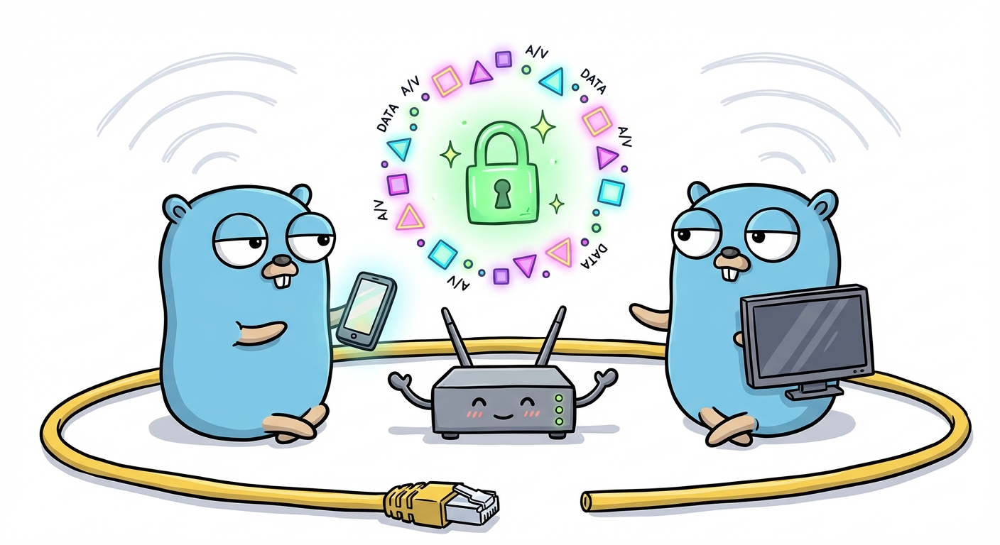

<h1 align="center">
  
   
  Network Protocol
</h1>
<h4 align="center">OpenScreen Protocol network layer implementation</h4>

  <a href="https://www.w3.org/TR/openscreen-network/">W3C Specification</a>

 

### Features

- QUIC transport with ALPN negotiation
- mDNS discovery and advertisement
- PSK authentication (SPAKE2)
- Agent fingerprint verification
- CBOR message encoding

### Authentication

SPAKE2 follows network.bs "Authentication with SPAKE2": identities A/B are
the client's and server's agent fingerprints, the password is the base-10 PSK
of Appendix B with dashes and leading zeros removed (`ParsePSK`, `FormatPSK`),
hashed with SHA-512, and either the PSK presenter (`psk-shown`) or the PSK
consumer (`psk-needs-presentation`) may initiate.

One deviation remains: the spec's edwards25519 suite is not implemented.
Agents must opt in to the RFC 9382 P-256 suite with
`InteropQuirks.Spake2SuiteP256` (Chromium's `osp_demo --spake2_suite=p256`);
without it `AuthenticatePSK` fails with `ErrSpake2SuiteUnsupported`.

### LP2P sessions

The LP2P session extension (local-peer-to-peer index.bs "Session extension")
is opt-in: `AgentConfig.SessionExtension` on a listening agent,
`DiscoveredAgent.DialSession` on the dialing one. Plain OSP agents are
unaffected, which keeps the `osp_demo` and `lp2p_demo` interop working.

- The client sends `lp2p-session-request` with the requesting origin on a
  new bidirectional stream once the agent-info-response lists
  `data-channels` or `quic-transport` (else `ErrSessionUnsupported`).
- The server reports it as `RequestingOrigin` and holds back its
  `auth-capabilities`. It refuses with `RefuseSession` (permanent-error,
  then the connection is closed once the client ended the stream, so the
  response isn't lost), asks for authentication with
  `RequestAuthentication` (sends `auth-capabilities`), or accepts with
  `CompleteSession` (success) once the client's certificate is verified by
  `AuthenticatePSK` or asserted with `TrustPeer`.
- The client waits for the cue with `AwaitSession`: `auth-capabilities`
  (authenticate) or success (accepted; still authenticate if the server's
  certificate isn't trusted, assuming the server's auth-capabilities equal
  its own as none were received). Only the client starts SPAKE2; a server
  that accepted on trust still answers a handshake after the hand-off.
- A second `lp2p-session-request`, or one received by an agent without the
  extension, is refused and closes the connection.

### WebTransport

The WebTransport extension (index.bs "WebTransport extension") pools
`WebTransportSession`s on the connection: `OpenWebTransport` and
`AcceptWebTransport` (accept or refuse), bidirectional and unidirectional
streams starting with `data-transport-stream`, datagrams as QUIC DATAGRAM
frames prefixed with the exchange-id (QUIC datagrams are enabled on every
connection), `Close` with code and reason (`data-transport-close` then FIN;
it waits for the peer's FIN so a connection close right after doesn't lose
it), `Drain`, and `ExportKeyingMaterial` with the exporter context of
WebTransport over HTTP/3. Stream error codes 0..2^32-1 map to QUIC
application error codes; 2^32 is session-gone, used for streams of unknown
or closed sessions (held for `webTransportHoldTimeout` while the session may
still be opening). Sessions aren't opened towards a peer that doesn't list
`quic-transport`. Dedicated (`q2q`) connections aren't implemented.

### Listeners

`Listener.Close` doesn't close the connections it accepted. quic-go closes
a server's connections with its listener, so the QUIC listener and its UDP
socket are closed once the last accepted connection ends; handshakes that
complete meanwhile are closed right away.

### Data channels

The LP2P data channel extension (local-peer-to-peer index.bs "Data channel
extension") follows the spec and interoperates with openscreen's `lp2p_demo`
(`test/lp2p-demo-interop`). Where the spec is silent, ospc does what
openscreen does:

- The acceptor answers a `data-channel-open-request` with a
  `data-channel-open-response` on the request's bidirectional stream, before
  any `data-frame`. `OpenDataChannel` returns only after a success response;
  any other result fails it with `ErrDataChannelRejected`, and no response
  within `DataChannelOpenTimeout` (or the context) fails it too.
- A `channel-id` above 65,534 is answered with `permanent-error`.
- Without an explicit ID, the QUIC client (requester side) allocates even
  IDs and the QUIC server (receiver side) odd IDs: the lowest ID of its
  parity not used by an open channel of the connection. An explicit ID that
  is in use fails with `ErrDataChannelIDInUse`, one of the peer's parity with
  `ErrDataChannelIDParity`. IDs from the peer are accepted whatever their
  parity; channels are told apart by their stream.
- Closing a channel closes the sending side of its stream (there is no close
  message).

### License

MIT License
